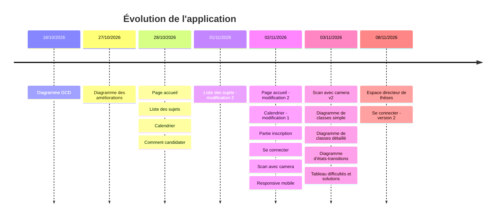
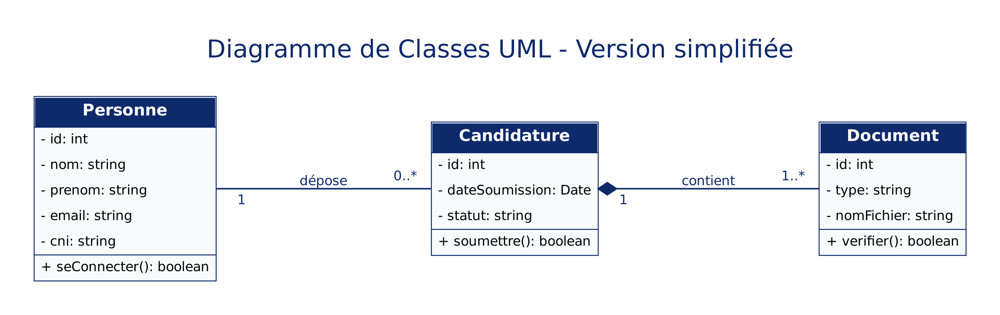
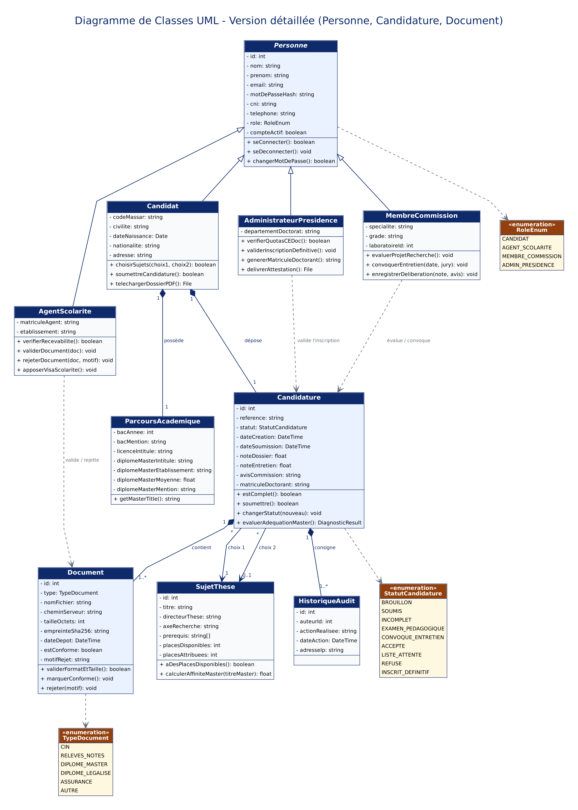
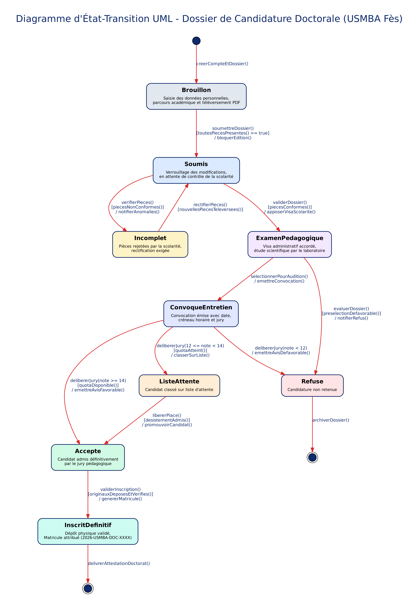
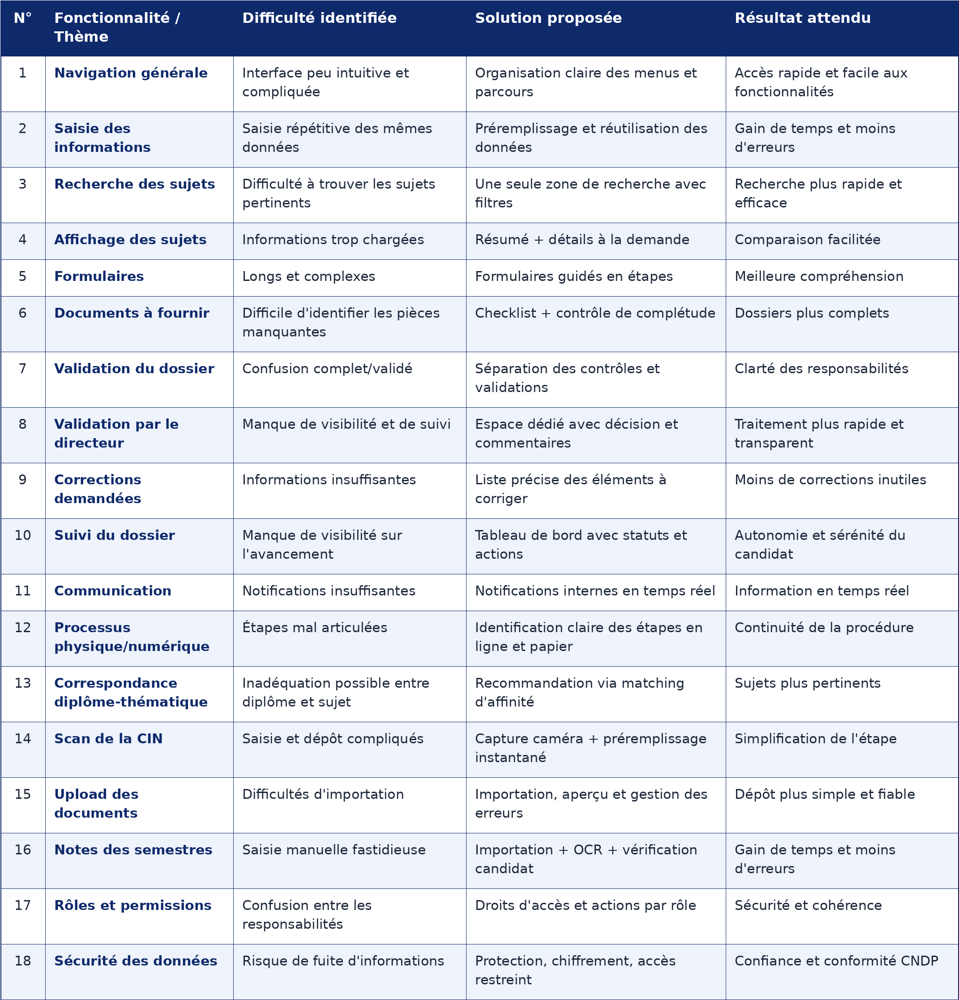

# Application Doctorat USMBA – État d'avancement

Captures de l'application, classées par date de dépôt.

## Axe de temps

## Avant / Après

| Page | Avant | Après |
|---|---|---|
| Page d'accueil |  |  |
| Calendrier |  |  |
| Scan avec caméra |  |  |
| Se connecter |  |  |

## Captures

| Date | Contenu | Capture |
|---|---|---|
| 18/10/2026 | Diagramme GCD |  |
| 27/10/2026 | Diagramme des améliorations de la plateforme |  |
| 28/10/2026 | Page d'accueil |  |
| 28/10/2026 | Liste des sujets |  |
| 28/10/2026 | Calendrier |  |
| 28/10/2026 | Comment candidater |  |
| 01/11/2026 | Liste des sujets – modification 2 (1) |  |
| 01/11/2026 | Liste des sujets – modification 2 (2) |  |
| 02/11/2026 | Page d'accueil – modification 2 |  |
| 02/11/2026 | Calendrier – modification 1 |  |
| 02/11/2026 | Partie d'inscription |  |
| 02/11/2026 | Se connecter |  |
| 02/11/2026 | Scan avec caméra |  |
| 02/11/2026 | Responsive au mobile |  |
| 03/11/2026 | Scan avec caméra – v2 |  |
| 03/11/2026 | Diagramme de classes simple |  |
| 03/11/2026 | Diagramme de classes détaillé |  |
| 03/11/2026 | Diagramme d'états-transitions |  |
| 03/11/2026 | Tableau des difficultés et solutions |  |
| 08/11/2026 | Espace directeur de thèses |  |
| 08/11/2026 | Se connecter – version 2 |  |
