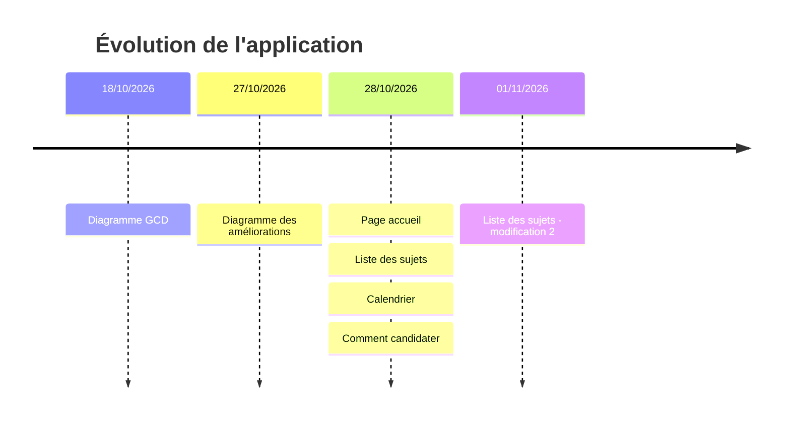

# Application Doctorat USMBA – État d'avancement

Captures de l'application, classées par date de dépôt.

## Axe de temps

## Avant / Après

| Avant (28/10/2026) | Après (01/11/2026) |
|---|---|
|  |  |

## Checklist d'avancement

- [x] Diagramme GCD
- [x] Diagramme des améliorations de la plateforme
- [x] Page d'accueil
- [x] Liste des sujets
- [x] Calendrier
- [x] Comment candidater
- [x] Modification de la liste des sujets
- [ ] Formulaire de candidature

## Captures

| Date | Contenu | Capture |
|---|---|---|
| 18/10/2026 | Diagramme GCD |  |
| 27/10/2026 | Diagramme des améliorations de la plateforme |
