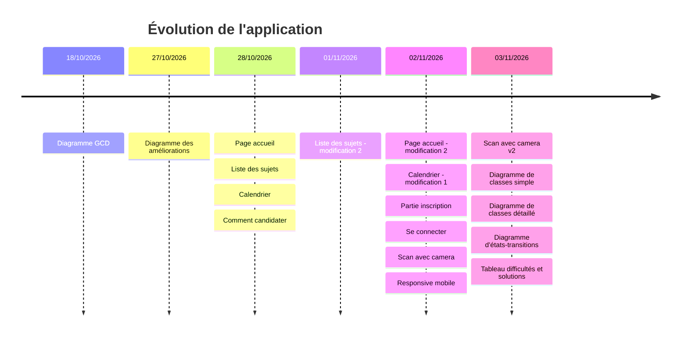
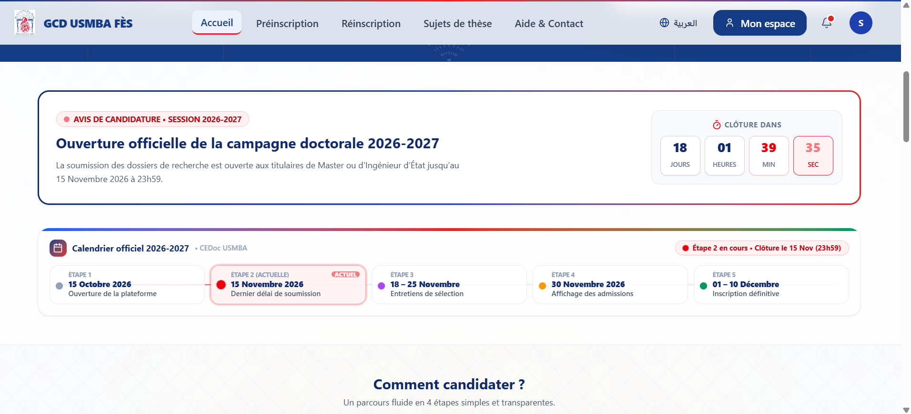
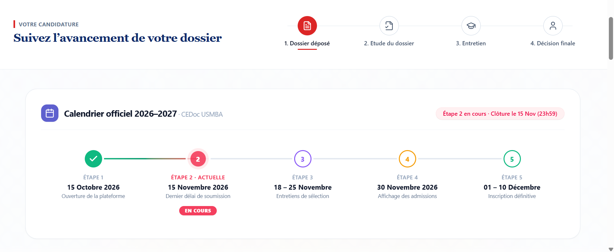

# Application Doctorat USMBA – État d'avancement

Captures de l'application, classées par date de dépôt.

## Axe de temps

## Avant / Après

| Page | Avant | Après |
|---|---|---|
| Page d'accueil |  |  |
| Calendrier |  |  |
| Liste des sujets (1) |  |  |
| Liste des sujets (2) |  |  |

## Checklist d'avancement

- [x] Diagramme GCD
- [x] Diagramme des améliorations de la plateforme
- [x] Page d'accueil
- [x] Liste des sujets
- [x] Calendrier
- [x] Comment candidater
- [x] Modification de la liste des sujets
- [x] Partie inscription
- [x] Se connecter
- [x] Scan avec caméra
- [x] Version responsive (mobile)
- [ ] Formulaire de candidature

| 02/11/2026 | Calendrier – modification 1 |  |
| 02/11/2026 | Partie d'inscription |  |
| 02/11/2026 | Se connecter |  |
| 02/11/2026 | Scan avec caméra |  |
| 02/11/2026 | Responsive au mobile |  |
